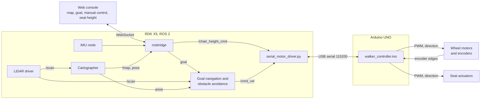
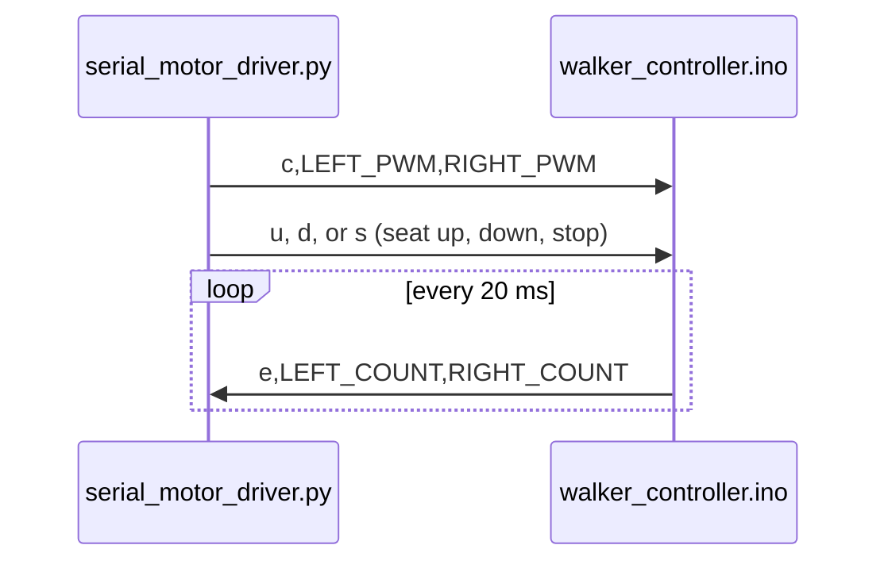
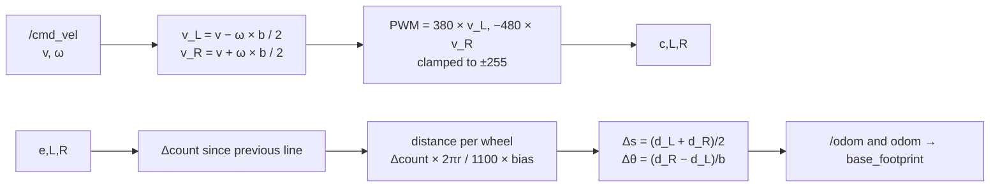
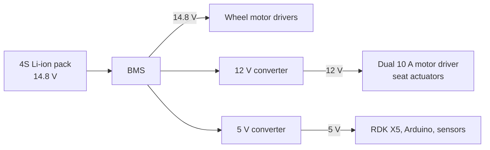

# Smart Indoor Walker

A full-size indoor walker for older adults. It maps a room with 2D LiDAR, drives to a point selected on the map, avoids obstacles, and raises or lowers the seat to help the user sit and stand.

Top Excellence Award, 2025 SDGs Social Problem-Solving Competition (Sep to Dec 2025)

Software: ROS 2, Cartographer, Python, Arduino
Hardware: RDK X5, 2D LiDAR, IMU, two DC gear motors with quadrature encoders, two linear actuators, Arduino UNO

## System



ROS 2 handles planning and motion. The Arduino controls the motors and counts encoder edges using interrupts, so Linux scheduling does not delay pulse counting.

## Serial link



| Line | Direction | Meaning |
|---|---|---|
| `c,<left>,<right>` | RDK X5 to Arduino | wheel PWM, −255 to 255 |
| `u`, `d`, `s` | RDK X5 to Arduino | seat up, down, stop |
| `e,<left>,<right>` | Arduino to RDK X5 | cumulative encoder counts |

The driver subscribes with a queue depth of 1, so it sends only the latest velocity command. The counts are cumulative, so a dropped line does not lose distance data.

## Base driver



| Parameter | Value |
|---|---|
| Wheel radius r | 0.038 m |
| Track b | 0.45 m |
| Encoder counts per wheel turn | 1100 |
| Left encoder factor | 1.0508 (the two encoders differed by 5%) |
| Odometry update | 50 Hz |

## Power



The motors and the logic are fed through separate converters.

## What I built

- Electronics: sensor selection, the two-controller architecture, and the three supply rails
- ROS 2 autonomy: LiDAR SLAM, goal navigation, and obstacle avoidance
- The base driver node and Arduino firmware in this repository
- The web console

## Result

The full-size prototype mapped a campus corridor, drove to goals selected on the map, and avoided obstacles. Parts cost KRW 320,000.

## Repository

```
ros2/serial_motor_driver.py
firmware/walker_controller/walker_controller.ino
```

## Run

```bash
python3 ros2/serial_motor_driver.py
```

The Arduino is expected at `/dev/ttyACM0`.