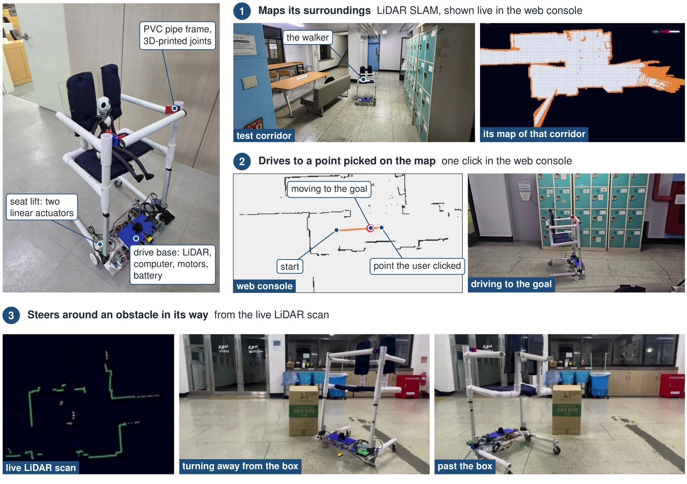

# Smart Indoor Walker

A full-size walker for older adults at home. It drives to a point selected on its map, avoids obstacles using live LiDAR scans, and raises or lowers its seat to help the user sit down and stand up.

Top Excellence Award, 2025 SDGs Social Problem-Solving Competition (Sep to Dec 2025)

Software: ROS 2, Cartographer, Python, Arduino  
Hardware: RDK X5, 2D LiDAR, IMU, wheel encoders, linear actuators



## Why

Over 70% of falls among older adults happen at home, most often while going to the toilet or sitting down and standing up (KDCA; Korea Consumer Agency). The walker drives to the user and assists with sitting and standing.

## System


- **High-level computer (RDK X5, ROS 2).** Runs LiDAR SLAM with Cartographer, drives to goals selected in the web console, avoids obstacles using live scans, and runs the base driver in this repository.
- **Low-level controller (Arduino UNO).** Counts wheel encoder edges using interrupts, drives two wheel motors and two seat actuators, and reports encoder counts every 20 ms.
- **Power.** One 4S Li-ion pack supplies the system. The wheel drivers use the pack voltage, the seat actuators use 12 V, and the controllers use 5 V.


## What I built

- Electronics: sensor selection, two-controller architecture, and three supply rails
- ROS 2 autonomy: LiDAR SLAM, goal driving, and obstacle avoidance
- The base driver node and Arduino firmware in this repository
- The web console: live map, goal selection, manual driving, and seat height control

## Design notes

- **Two controllers.** The Arduino counts encoder edges using interrupts, so Linux scheduling cannot delay pulse counting.
- **Serial link.** The driver retains only the latest velocity command. Encoder counts are cumulative, so a dropped line does not lose distance data.
- **Calibrated odometry.** The two encoders differed by 5%, so each wheel has separate factors for counts and PWM.
- **Linear actuators for the seat.** Selected instead of a stepper with a lead screw or a servo. Each costs KRW 25,000 and uses a standard motor driver.

## Result

- The full-size prototype mapped a campus corridor, drove to goals selected on the map, and steered around obstacles.
- Parts cost: KRW 320,000.

## Repository

```
ros2/serial_motor_driver.py                        base driver node: velocity command to wheel PWM, encoder counts to odometry
firmware/walker_controller/walker_controller.ino   Arduino firmware: encoders, wheel motors, seat actuators
docs/                                              figures
```

## Serial protocol

| Direction | Line | Meaning |
|---|---|---|
| RDK X5 → Arduino | `c,<left>,<right>` | wheel PWM, −255 to 255 |
| RDK X5 → Arduino | `u` / `d` / `s` | seat up, down, stop |
| Arduino → RDK X5 | `e,<left>,<right>` | cumulative encoder counts, every 20 ms |

## Run

```bash
python3 ros2/serial_motor_driver.py
```

The node subscribes to `cmd_vel` and `/chair_height_cmd`, publishes `odom` and the `odom → base_footprint` transform, and expects the Arduino at `/dev/ttyACM0` with a baud rate of 115200.