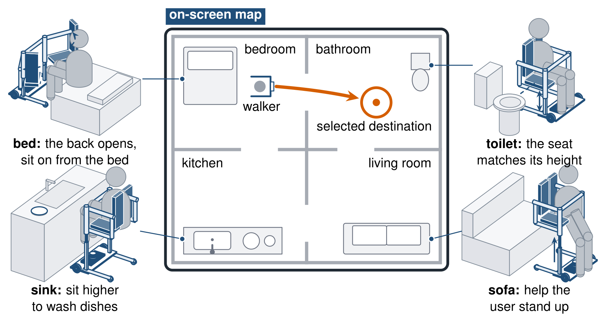
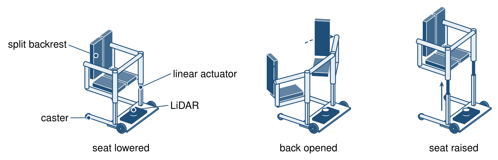
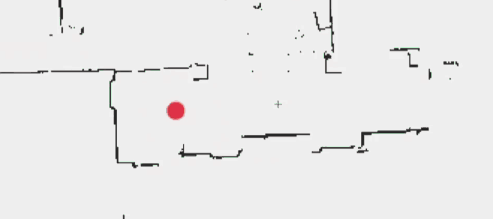
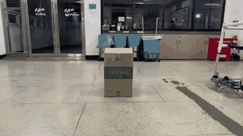

# Smart Indoor Walker

A powered indoor walker for people who need help sitting down, standing up or walking when no caregiver is home. It carries a seated user between rooms: the user selects a destination on a map in the web console, and the walker drives there with ROS 2 navigation. Built for the 2025 SDGs Social Problem-Solving Competition (Top Excellence Award).



Tested in a campus corridor: Cartographer built the map, and the walker drove to destinations selected in the web console. Prototype parts cost KRW 320,000; a full-time care worker earns over KRW 2 million a month.

**Technical summary**

- **Two controllers.** An Arduino Uno counts the encoder edges in interrupts and drives the motors; the RDK X5 runs ROS 2 and exchanges commands and cumulative encoder counts with it over a text serial protocol.
- **Goal navigation from a web console.** A destination selected on the map reaches Nav2 through rosbridge and a goal bridge node.
- **Scan-based obstacle avoidance.** A* on a 5 cm grid rebuilt from each LiDAR scan, tested in simulation.
- **Odometry calibration.** A per-wheel scale factor corrects a 5% difference between the left and right encoders.

## Problem and users

The walker is designed for two groups:

- people who cannot walk on their own, such as wheelchair users, and need to move while seated;
- people who can walk but have difficulty indoors, especially when going to the toilet, sitting down or standing up.

In Korea, over 70% of falls among older adults happen at home, many of them slips in the bathroom or falls from bed ([Korea Consumer Agency, 2022](https://kca.go.kr/home/sub.do?menukey=4006&mode=view&no=1003370972)). The walker is designed around these moments: getting out of bed, going to the toilet, and sitting down or standing up when no caregiver is present.

Conventional walkers do not carry a seated user. This walker keeps the user seated while it drives between rooms and adjusts the seat height to a bed, a chair or a toilet. The seat lift also assists standing up, which is useful in rehabilitation, and the user can do household tasks such as washing dishes or cleaning while seated. The design targets four places in the home: the bed, the toilet, the kitchen sink and the sofa.

## Design requirements

- **Load and thresholds.** Carry a seated adult over the door thresholds between rooms.
- **Seat height.** Match the height of a bed, a chair and a toilet.
- **Rear entry.** Let the user sit down directly from a bed or a sofa, so the frame opens at the back.
- **Cost.** Prototype parts cost KRW 320,000. A product version with a sturdier frame and after-sales service was estimated at KRW 500,000 to 550,000. For comparison, a full-time care worker earns over KRW 2 million a month ([Ministry of Health and Welfare, 2025 Long-Term Care Survey](https://mohw.go.kr/board.es?act=view&bid=0027&list_no=1491533&mid=a10503010100)).
- **Funding.** Distribution through Korean support programs was considered: assistive devices for people with disabilities, welfare equipment under long-term care insurance, and local programs for older adults.

## System architecture


Dashed boxes are existing packages, boxes with a solid colored outline are code in this repository, and grey boxes are hardware.

- **Existing packages, used unmodified:** Cartographer (SLAM), Nav2 (path planning and goal navigation), rosbridge (between ROS 2 and the browser) and the LiDAR driver (`bluesea2`).
- **Developed for this project:** the frame, the electronics, the Arduino firmware, the ROS 2 nodes (motor driver, odometry, IMU, goal bridge, obstacle avoidance), the robot model with the Cartographer configuration, and the web console.

## Mechanical design



The base is a U-shaped frame that is open at the rear, with casters at the rear ends and the drive wheels and the electronics plate (with the LiDAR) at the front. Two linear actuators at the front corners raise and lower the entire upper frame. The seat and the backrest are split into left and right halves, and each half swings outward with its armrest. A removable bar closes the rear.

Linear actuators were chosen for the seat lift over a NEMA 17 stepper with a T8 lead screw and over MG996R servos, because they cost less and run from a standard DC motor driver. Both actuators (12 V, 300 N) are driven together by one dual-channel MDD10A driver.

The drive uses two JGB37-520 geared DC motors with quadrature encoders, 76 mm wheels and a 0.45 m track width. One wheel revolution is 1,100 encoder counts.

## Low-level control and serial protocol

The RDK X5 runs Linux and ROS 2. An Arduino Uno handles the encoder interrupts and drives the wheel motors and the seat actuators, so encoder counting is not affected by Linux scheduling.

The two boards communicate over USB serial at 115200 baud with short text messages:

| Direction | Message | Meaning |
|---|---|---|
| RDK X5 to Arduino | `c,<left PWM>,<right PWM>` | Wheel command; only the latest one is applied |
| RDK X5 to Arduino | `u`, `d`, `s` | Seat up, down, stop |
| Arduino to RDK X5 | `e,<left count>,<right count>` | Cumulative encoder counts, every 20 ms |

Because the counts are cumulative, a lost message delays one odometry update but loses no distance.

`ros2/serial_motor_driver.py` converts the counts to odometry. The left and right encoder readings differed by 5%, so the left count is scaled by 1.0508 (`ros2/diff_drive.py`). Without this factor, straight driving appeared curved in the odometry.

## Goal navigation from the web console



The web console during a run on the campus corridor map: after a destination is selected, Nav2's path appears (orange) and the walker's position (red) moves from the start (green) to the destination.

The web console (React, roslib) connects to ROS 2 through rosbridge. A destination selected on the map is published to `/goal_pose`. `ros2/goal_bridge.py` sends it to Nav2 as a `NavigateToPose` action, and Nav2 plans and follows a path on the saved map. The stop button publishes `/stop_nav`, which cancels the goal and publishes zero velocity. The seat can also be raised and lowered from the console. Goal navigation was the main function shown in the demonstration.

## Scan-based obstacle avoidance

Obstacle avoidance is a separate driving mode from Nav2 goal navigation. `ros2/avoidance_controller.py` is started and stopped from the console (`/avoidance_cmd`), drives toward a target point ahead (5 m by default) and publishes velocity commands directly. On each LiDAR scan it calls `ros2/local_planner.py`, which builds a 5 cm occupancy grid, inflates obstacles by the walker's radius (0.30 m), adds cost near obstacles and plans a path to the target with A*. Only cells crossed by a LiDAR ray are treated as free. This mode was tested in simulation.

## Onboard processing

Mapping, localization and path planning run on the RDK X5; the browser only displays the map and sends goals. Navigation does not depend on the network, so there is no network latency in the control loop. The map of the user's home stays on the device, and no server is needed.

## Results

**On the hardware.** Cartographer mapped a campus corridor, and the walker drove to destinations selected in the web console. The seat lift, the rear opening and obstacle avoidance around a box were demonstrated in the final round of the competition.



**In simulation.** In a corridor 2.8 m wide with three obstacles, the scan-based avoidance mode reached a goal 7.5 m ahead. The minimum distance between the walker's outline (radius 0.30 m) and a wall was 16 cm.


## Repository structure

| Path | Contents |
|---|---|
| `firmware/walker_controller/` | Arduino firmware: encoder interrupts, wheel PWM, seat actuators, serial protocol |
| `ros2/serial_motor_driver.py`, `ros2/diff_drive.py` | Serial link to the Arduino, wheel commands, odometry |
| `ros2/goal_bridge.py` | Goals from the web console to Nav2 |
| `ros2/avoidance_controller.py`, `ros2/local_planner.py` | Scan-based obstacle avoidance mode |
| `ros2/imu_node.py` | IMU node |
| `ros2/good_bot/` | Robot model (URDF), launch files, Cartographer configuration |
| `maps/` | Saved map |
| `web/` | Web console |
| `docs/` | Figures |

## Setup and run

Software: Ubuntu 22.04 and ROS 2 Humble on the RDK X5; Node.js and npm for the web console.

1. Upload `firmware/walker_controller/walker_controller.ino` to the Arduino Uno and connect it to the RDK X5 by USB. The motor driver node opens `/dev/ttyACM0` at 115200 baud; add the user to the `dialout` group for access (`sudo usermod -aG dialout $USER`, then log in again).
2. Connect the LiDAR to the RDK X5's Ethernet port and give `eth0` an address on the LiDAR's subnet:

   ```sh
   sudo ip addr add 192.168.158.15/24 dev eth0
   sudo ip link set eth0 up
   ```

3. On the RDK X5, with the LiDAR driver and the Humble packages of Cartographer, Nav2 and rosbridge installed and `ros2/good_bot` built in a workspace:

   ```sh
   ros2 launch bluesea2 udp_lidar.launch
   ros2 launch good_bot display.launch.py
   ros2 run tf2_ros static_transform_publisher 0 0 0 0 0 0 base_footprint base_link
   python3 ros2/imu_node.py
   ros2 launch rosbridge_server rosbridge_websocket_launch.xml
   python3 ros2/serial_motor_driver.py
   ```

4. Mapping: `ros2 launch good_bot cartographer.launch.py`
5. Goal navigation on the saved map:

   ```sh
   ros2 launch nav2_bringup bringup_launch.py map:=maps/room1.yaml
   python3 ros2/goal_bridge.py
   ```

6. Obstacle avoidance mode: `python3 ros2/avoidance_controller.py`
7. Web console: `cd web && npm install && npm start`
