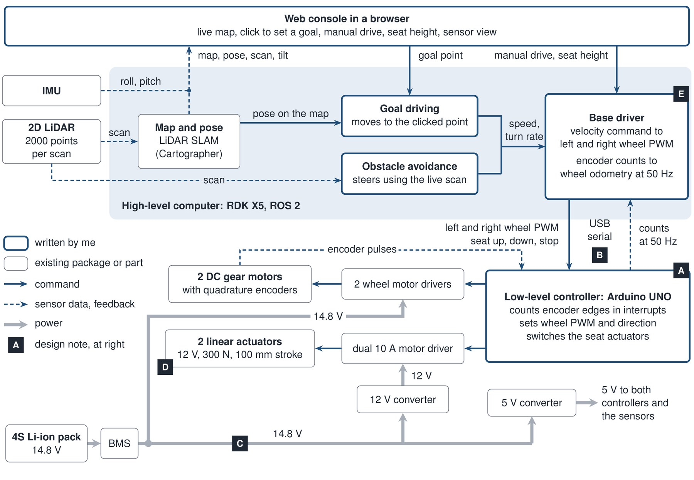
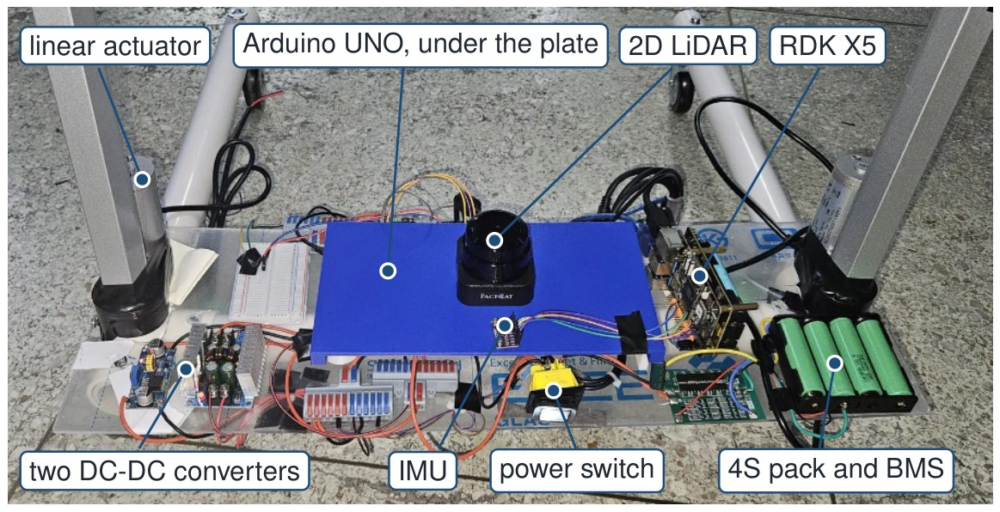

# Smart Indoor Walker

A full-size walker for older adults at home. It drives itself to a point picked on its map, avoids obstacles from a live LiDAR scan, and raises and lowers its seat to help the user sit down and stand up.

**Top Excellence Award, 2025 SDGs Social Problem-Solving Competition** · Sep – Dec 2025 · ROS 2, Cartographer, Python, Arduino · RDK X5, 2D LiDAR, IMU, wheel encoders, linear actuators


## Why

Over 70% of falls among older adults happen at home, most often on the way to the toilet or when sitting down or standing up (KDCA; Korea Consumer Agency). The walker brings itself to the user and helps with sitting and standing.

## System



- **High-level computer (RDK X5, ROS 2):** LiDAR SLAM with Cartographer, goal driving to the point clicked in the web console, obstacle avoidance from the live scan, and the base driver in this repository.
- **Low-level controller (Arduino UNO):** counts the wheel encoder edges in interrupts, drives the two wheel motors and the two seat actuators, and reports encoder counts every 20 ms.
- **Power:** one 4S Li-ion pack. The wheel drivers run on the pack voltage, the seat actuators on 12 V, the controllers on 5 V.



## What I built

- Electronics: sensor selection, the two-controller split and the three supply rails
- ROS 2 autonomy: LiDAR SLAM, goal driving, obstacle avoidance
- The base driver node and the Arduino firmware in this repository
- The web console: live map, goal, manual drive, seat height

## Design notes

- **Two controllers.** Encoder edges are counted in interrupts on the Arduino, so Linux scheduling cannot delay pulse counting.
- **Serial link.** The driver keeps only the latest velocity command. Encoder counts are sent as running totals, so a dropped line loses no distance.
- **Calibrated odometry.** The two encoders disagreed by 5%, so each wheel has its own factor for counts and for PWM.
- **Linear actuators for the seat.** Chosen over a stepper with a lead screw and over a servo: KRW 25,000 each, driven by a standard motor driver.

## Result

- The full-size prototype mapped a campus corridor, drove to goals clicked on the map and steered around obstacles.
- Parts cost: KRW 320,000.

## Repository

```
ros2/serial_motor_driver.py                   base driver node: velocity command to wheel PWM, encoder counts to odometry
firmware/walker_controller/walker_controller.ino   Arduino firmware: encoders, wheel motors, seat actuators
docs/                                         figures
```

## Serial protocol

| Direction | Line | Meaning |
|---|---|---|
| RDK X5 → Arduino | `c,<left>,<right>` | wheel PWM, −255 to 255 |
| RDK X5 → Arduino | `u` / `d` / `s` | seat up, down, stop |
| Arduino → RDK X5 | `e,<left>,<right>` | cumulative encoder counts, every 20 ms |

## Run

```bash
python3 ros2/serial_motor_driver.py
```

The node subscribes to `cmd_vel` and `/chair_height_cmd` and publishes `odom` and the `odom → base_footprint` transform. The Arduino is expected on `/dev/ttyACM0` at 115200 baud.
