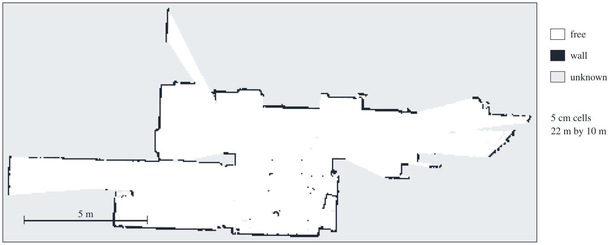

# Smart Indoor Walker

A full-size walker for older adults at home. It maps a floor with a 2D LiDAR, drives to a point picked on that map in a web console, steps around an obstacle, and raises and lowers its seat.

The walker was built from September to December 2025 for the 2025 SDGs Social Problem-Solving Competition. This repository holds its software, cleaned up afterward, and a script that checks the odometry code on a PC.

| Part | |
|---|---|
| Computer | RDK X5, ROS 2 Humble |
| Low-level controller | Arduino UNO |
| Sensors | 2D LiDAR, BNO085 IMU, two wheel encoders |
| Actuators | two DC gear motors, two linear actuators for the seat |
| Console | React in a browser, roslib over a rosbridge WebSocket |

## How it works


The console talks to ROS through rosbridge. Clicking the map publishes a pose on `/goal_pose`. `goal_bridge.py` forwards it to Nav2, which localizes on the saved map with AMCL and publishes `cmd_vel`. The console also sends the drive pad as `cmd_vel`, the seat height, and the start and stop of the obstacle routine.

Mapping and goal driving are separate modes. Cartographer builds the map from the LiDAR and the IMU, without wheel odometry. The map is saved, and Nav2 then loads it. Nav2, the obstacle routine and the drive pad all publish `cmd_vel` with no arbitration between them, so one is used at a time.

`serial_motor_driver.py` turns `cmd_vel` into one PWM value per wheel and sends it to the Arduino as a text line. The Arduino drives the motors and counts encoder A edges in interrupts, independently of the serial read loop on the Linux side. It reports the running totals 50 times a second, and the driver integrates them into `/odom` and the `odom` to `base_footprint` transform.

The left and right PWM gains are 380 and 480 per m/s. The odometry scales the left encoder increments by 1.0508 and the right ones by 1.0.

## Map



This is the map the walker saved on 1 December 2025, drawn from `maps/room1.pgm`. Nav2 loads `maps/room1.yaml`, which references this image.

## Odometry checks

These are simulations, not measurements on the walker. `sim/odometry_check.py` generates encoder totals and feeds them to `WheelOdometry`, the class the driver uses.


The first check is the wheel factor. On a straight drive with a left encoder that under-reads by the calibrated amount, the raw counts turn the estimated heading by 6.1 degrees per metre, which puts the estimate 0.47 m to the side after 3 m. With the factor the estimate stays on the line. The stream is generated with the same factor, so this shows what the correction is worth, not how accurate the calibration is.

The second check is the serial format. The Arduino sends running totals, not the counts since the last line. Each line of an 8 m S-curve is dropped with a given probability, and the final position is compared with a run that loses nothing. Over 200 trials, the mean difference stays under 2 cm for running totals even at a drop probability of 50%. If each line carried an increment, the mean difference would be about 1.5 m at 20%.

## Serial lines

| Direction | Line | Meaning |
|---|---|---|
| to the Arduino | `c,<left>,<right>` | wheel PWM, -255 to 255 |
| to the Arduino | `u`, `d`, `s` | seat up, down, stop |
| from the Arduino | `e,<left>,<right>` | running encoder totals, every 20 ms |

The driver keeps only the newest `cmd_vel` in its queue.

## Repository

```text
ros2/serial_motor_driver.py   cmd_vel to wheel PWM, encoder totals to /odom and TF
ros2/diff_drive.py            kinematics and odometry, no ROS dependency
ros2/goal_bridge.py           /goal_pose to the Nav2 navigate_to_pose action
ros2/avoidance_controller.py  obstacle routine
ros2/imu_node.py              BNO085 over I2C to /imu
ros2/good_bot/                robot model, Cartographer configuration, launch files
firmware/walker_controller/   Arduino sketch: motors, encoders, seat actuators
web/                          console
maps/                         saved map
sim/odometry_check.py         odometry checks
docs/                         figures
```

## Run

On the RDK X5, with the LiDAR driver, Cartographer, Nav2 and rosbridge installed and `ros2/good_bot` built in a workspace:

```sh
ros2 launch bluesea2 udp_lidar.launch
ros2 launch good_bot display.launch.py
python3 ros2/imu_node.py
ros2 launch rosbridge_server rosbridge_websocket_launch.xml
ros2 run tf2_ros static_transform_publisher 0 0 0 0 0 0 base_footprint base_link
python3 ros2/serial_motor_driver.py
```

Mapping:

```sh
ros2 launch good_bot cartographer.launch.py
```

Driving to a goal on the saved map:

```sh
ros2 launch nav2_bringup bringup_launch.py use_sim_time:=false map:=maps/room1.yaml
python3 ros2/goal_bridge.py
```

Obstacle routine:

```sh
python3 ros2/avoidance_controller.py
```

Console:

```sh
cd web
npm install
npm start
```

Odometry checks, on any PC with Python:

```sh
python3 sim/odometry_check.py calibration > calibration.csv
python3 sim/odometry_check.py loss > loss.csv
```
