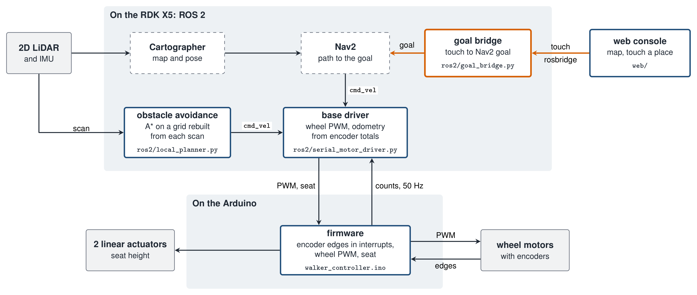

# Smart Indoor Walker

A powered indoor walker for people who need help sitting down, standing up or walking when no caregiver is home. The user sits on it, touches a place on the map on its screen, and the walker drives there. Built for the 2025 SDGs Social Problem-Solving Competition (Top Excellence Award).



## Built to carry a seated person

In Korea, over 70% of falls among older adults happen at home (KDCA; Korea Consumer Agency). Conventional walkers do not carry a seated user. This one does, and the hardware was designed around that load.

- **Thresholds and weight.** The wheels have to get over door thresholds with a person on the frame, so the motors and their driver were chosen with margin.
- **A seat set to furniture height.** Two linear actuators raise and lower the seat to the height of a bed, a chair or a toilet, and the back of the frame opens so the user can sit down from a bed or a sofa.

## Touch a place, and the walker goes there

A touch on the map in the web console becomes a goal pose, and Nav2 drives the walker there on the saved map. This was the centre of the project and of the demo.

## Mapping and control run on the walker

Mapping, localization and planning run on the RDK X5, while the browser draws the map and sends goals. Once a goal is received, the walker drives on its own and keeps driving when the Wi-Fi drops. The map of the user's home is stored on the device. An Arduino counts the encoder edges in interrupts and drives the motors and the seat, so their timing does not depend on Linux.

## Run

On the RDK X5, with the LiDAR driver, Cartographer, Nav2 and rosbridge installed and `ros2/good_bot` built in a workspace:

```sh
ros2 launch bluesea2 udp_lidar.launch
ros2 launch good_bot display.launch.py
python3 ros2/imu_node.py
ros2 launch rosbridge_server rosbridge_websocket_launch.xml
python3 ros2/serial_motor_driver.py
```

Mapping: `ros2 launch good_bot cartographer.launch.py`

Driving to a goal on the saved map:

```sh
ros2 launch nav2_bringup bringup_launch.py map:=maps/room1.yaml
python3 ros2/goal_bridge.py
```

Console: `cd web && npm install && npm start`
