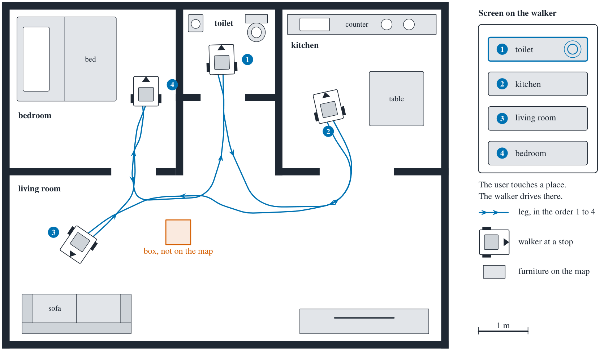
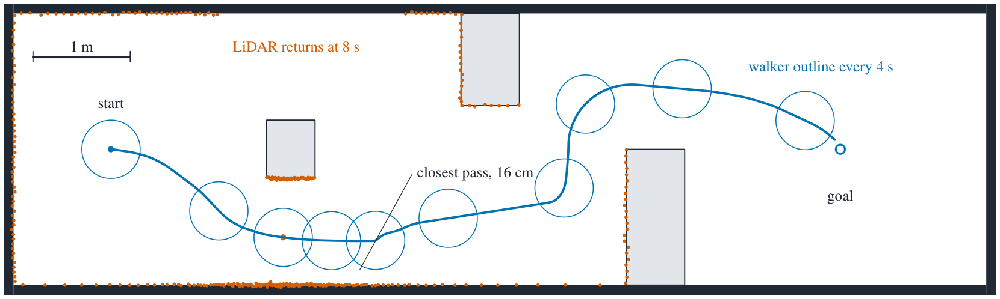
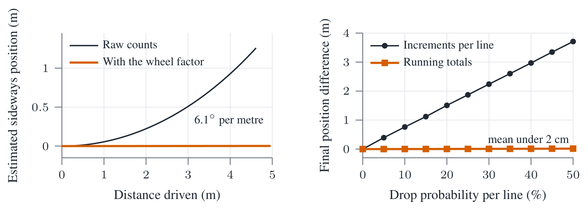

# Smart Indoor Walker

A full-size indoor walker for people who cannot walk safely on their own at home. The user sits on it, touches a point on the map shown on its screen, and the walker drives there. The seat rises and lowers to match a chair, a bed or a toilet.

Over 70% of falls among older adults happen at home, most often on the way to the toilet or while sitting down and standing up (KDCA; Korea Consumer Agency). Those accidents cluster at the moment of sitting down or standing up, and at night, when nobody else is around. Existing walking aids do not move a seated person, so they do not help someone who cannot stand. The project asked whether a person could spend the day on one device and still get to where they want to go without waiting for help.

The prototype was built from September to December 2025 for the 2025 SDGs Social Problem-Solving Competition. In the demo it mapped a campus corridor, drove to a point picked on the map, and lifted its seat.

## The home it is meant for



*Simulation, to scale.*

The walker is meant to be used like this: the user is in the bedroom, touches the toilet on the map, and is taken there. The map is divided into named places. `maps/home_places.yaml` gives each place its area and the pose to stop at, and `ros2/places.py` turns a touch into the place it falls in and that place into a goal.

The figure is a simulated run through a 9 m by 7 m home with 0.9 m doors, from the bedroom to the toilet, the kitchen, the living room and back. All four legs arrive, 24 m in about two minutes, with an obstacle on the way that the map does not contain.

## What it had to do

Most of the early work went into questions about the hardware and the user, before any software.

- **Carry a seated person through a home.** The wheels have to get over door thresholds and the motors have to move the loaded frame. The wheel motors and their driver were chosen with margin for this instead of by price. They are KRW 80,000 of the KRW 320,000 in parts; the LiDAR is 100,000, the frame 50,000, the two seat actuators 50,000 and the electronics 40,000.
- **Let the user stay on it.** The seat height adjusts to the chair, bed or toilet the user is moving to, and the rear of the frame opens so the user can sit down straight from a bed or sofa.
- **Go where the user points.** Touching the map and arriving there had to work every time and without a wait. This was the centre of the project and of the demo.
- **Be affordable to the people who need it.** A paid caregiver costs around KRW 2,000,000 a month. The parts cost KRW 320,000, and the selling price was estimated at about KRW 500,000 once the frame is made of a sturdier material and the build is serviceable. The project also checked which support programs such a device could fall under: the assistive device support program, welfare equipment under long-term care insurance, and local government programs for older adults.

| Part | |
|---|---|
| Computer | RDK X5, ROS 2 Humble |
| Low-level controller | Arduino UNO |
| Sensors | 2D LiDAR, BNO085 IMU, two wheel encoders |
| Actuators | two DC gear motors, two linear actuators for the seat |
| Console | React in a browser, roslib over a rosbridge WebSocket |

## How it works


The console talks to ROS through rosbridge. Clicking the map publishes a pose on `/goal_pose`. `goal_bridge.py` forwards it to Nav2, which localizes on the saved map with AMCL and publishes `cmd_vel`. The drive pad publishes `cmd_vel`. The console also sends seat up, down and stop commands, and starts and stops obstacle avoidance.

Mapping and goal driving are separate modes. Cartographer builds the map from the LiDAR and the IMU. The map is saved, and Nav2 then loads it. Nav2, obstacle avoidance and the drive pad all publish `cmd_vel`. There is no command mux, so only one of them is run at a time, and the software does not enforce this.

`serial_motor_driver.py` turns `cmd_vel` into one PWM value per wheel and sends it to the Arduino as a text line. The Arduino drives the motors, counts encoder edges, and reports the totals 50 times a second. The driver integrates them into `/odom` and the `odom` to `base_footprint` transform.

## Design decisions

**Everything runs on the walker.** The alternative was to send the scans to a PC or a server and compute there. Mapping, localization and planning run on the RDK X5 instead, and the browser only draws the map and sends touches. A touch turns into motion without a round trip over the network, the walker keeps driving when the home Wi-Fi drops, the map of the user's home never leaves the device, and there is no server to pay for or keep running.

**Two controllers.** The alternative was to wire the motor drivers and encoders straight to the RDK X5. Encoder edges have to be counted as they arrive, though, and a Linux process next to SLAM cannot promise that. The Arduino counts encoder A edges in interrupts, independently of the serial read loop on the Linux side, and the RDK X5 does everything that needs ROS.

**Running totals on the serial link.** The Arduino could send the counts since its last line, which keeps the numbers small. A dropped line would then lose distance for good. It sends running totals instead, and the driver takes differences, so a lost line only delays the update.

**Newest command only.** The driver keeps a `cmd_vel` queue of depth 1. If commands arrive faster than they are written to the serial port, the old ones are dropped instead of reaching the motors late.

**One factor per wheel.** The two encoders disagreed by 5%. A single wheel radius cannot absorb that, so the odometry scales the left encoder increments by 1.0508 and the right ones by 1.0. The speed-to-PWM gains are set per wheel as well, 380 and 480 per m/s.

**Linear actuators for the seat.** The seat has to lift a person, so a stepper with a lead screw and a hobby servo were compared with linear actuators. The actuators are rated 300 N over a 100 mm stroke at 12 V, cost KRW 25,000 each, and run from a standard DC motor driver.

**A local path search for obstacle avoidance.** The avoidance went through three approaches, each tried in simulation. Marking the beams around each LiDAR return as blocked closed gaps that the walker model fits through. Choosing a heading by how far a walker-wide strip is free got through gaps, but circled in front of an obstacle, because it only looks one step ahead. `local_planner.py` now builds a 5 cm grid from each scan, blocks the cells within the walker radius of a return, makes the next 30 cm expensive and the first 15 cm of that more so, and searches a path to the goal with A*. Two more problems showed up. With an obstacle straight ahead, successive plans alternated between passing on the left and on the right, so the planner now keeps the side it chose, measured against the direction to the goal, until the path is straight again. And in the home simulation the walker turned away from a doorway: cells behind walls counted as free, so a long way round through space it could not see looked cheaper than the door. Only cells that a LiDAR ray has crossed are now free.

## Map


This is the map the walker saved on 1 December 2025, drawn from `maps/room1.pgm`. Nav2 loads `maps/room1.yaml`, which references this image.

## Checks on a PC

These checks are simulations. Each one imports the planner or odometry module from `ros2/` unchanged.

### Obstacle avoidance



`sim/avoidance_sim.py` puts `local_planner.py` in a corridor 2.8 m wide with three obstacles. The LiDAR is simulated with 360 beams and Gaussian range noise of 1 cm standard deviation, and the goal is 7.5 m ahead. In this one seeded run, a circular model of 0.30 m radius stops 11 cm from the goal after 37.3 s and 8.7 m of travel, and its closest pass to a wall is 16 cm. `sim/home_sim.py` is the run through the home shown above; there the closest pass is 12 cm, in the doorways. The walker is modelled as a circle.

### Wheel odometry



`sim/odometry_check.py` generates encoder totals and feeds them to `WheelOdometry`, the class the driver uses.

On a straight drive with a left encoder that under-reads by the calibrated amount, the raw counts turn the estimated heading by 6.1 degrees per metre, which puts the estimate 0.47 m to the side after 3 m. With the factor the estimate stays on the line. The stream is generated with the same factor, so this shows what the correction is worth, not how accurate the calibration is.

For the serial format, each line of an 8 m S-curve is dropped with a given probability, and the final position is compared with a run that loses nothing. Over 200 trials, the mean difference stays under 2 cm for running totals even at a drop probability of 50%. If each line carried an increment, the mean difference would be about 1.5 m at 20%.

## Serial lines

| Direction | Line | Meaning |
|---|---|---|
| to the Arduino | `c,<left>,<right>` | wheel PWM, -255 to 255 |
| to the Arduino | `u`, `d`, `s` | seat up, down, stop |
| from the Arduino | `e,<left>,<right>` | running encoder totals, every 20 ms |

## Repository

```text
ros2/serial_motor_driver.py   cmd_vel to wheel PWM, encoder totals to /odom and TF
ros2/diff_drive.py            kinematics and odometry, no ROS dependency
ros2/goal_bridge.py           /goal_pose to the Nav2 navigate_to_pose action
ros2/avoidance_controller.py  obstacle avoidance node
ros2/local_planner.py         grid path search from a scan, no ROS dependency
ros2/places.py                named places on the map
ros2/imu_node.py              BNO085 over I2C to /imu
ros2/good_bot/                robot model, Cartographer configuration, launch files
firmware/walker_controller/   Arduino sketch: motors, encoders, seat actuators
web/                          console
maps/                         saved map, and the simulated home with its places
sim/                          checks on a PC
docs/                         figures
```

## Run

On the RDK X5, with the LiDAR driver, Cartographer, Nav2 and rosbridge installed and `ros2/good_bot` built in a workspace:

```sh
ros2 launch bluesea2 udp_lidar.launch
ros2 launch good_bot display.launch.py
python3 ros2/imu_node.py
ros2 launch rosbridge_server rosbridge_websocket_launch.xml
ros2 run tf2_ros static_transform_publisher 0 0 0 0 0 0 base_footprint base_link
python3 ros2/serial_motor_driver.py
```

Mapping:

```sh
ros2 launch good_bot cartographer.launch.py
```

Driving to a goal on the saved map:

```sh
ros2 launch nav2_bringup bringup_launch.py use_sim_time:=false map:=maps/room1.yaml
python3 ros2/goal_bridge.py
```

Obstacle avoidance:

```sh
python3 ros2/avoidance_controller.py
```

Console:

```sh
cd web
npm install
npm start
```

Checks, on any PC with Python:

```sh
python3 sim/home.py
python3 sim/home_sim.py > home.csv
python3 sim/avoidance_sim.py > avoidance.csv
python3 sim/odometry_check.py calibration > calibration.csv
python3 sim/odometry_check.py loss > loss.csv
```
